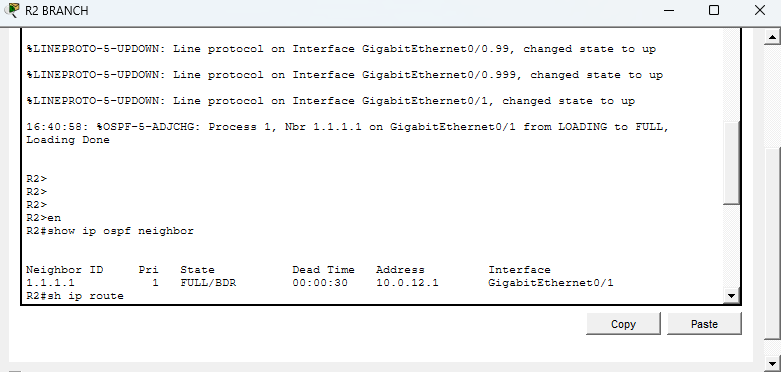
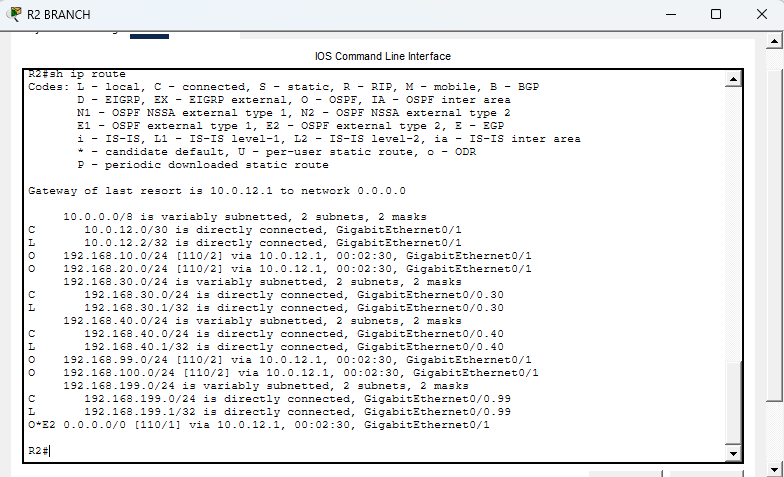
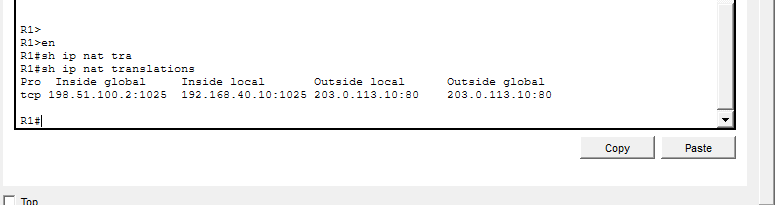
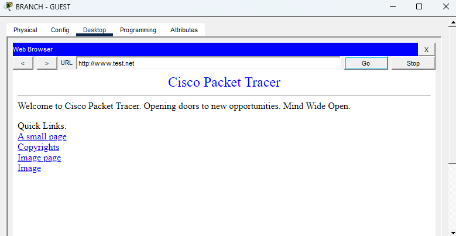
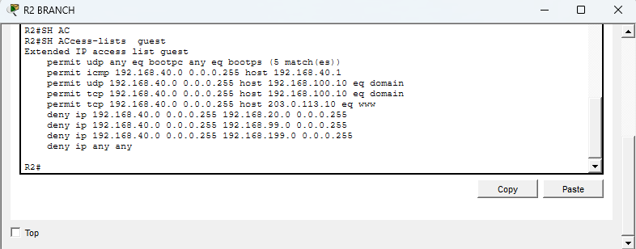
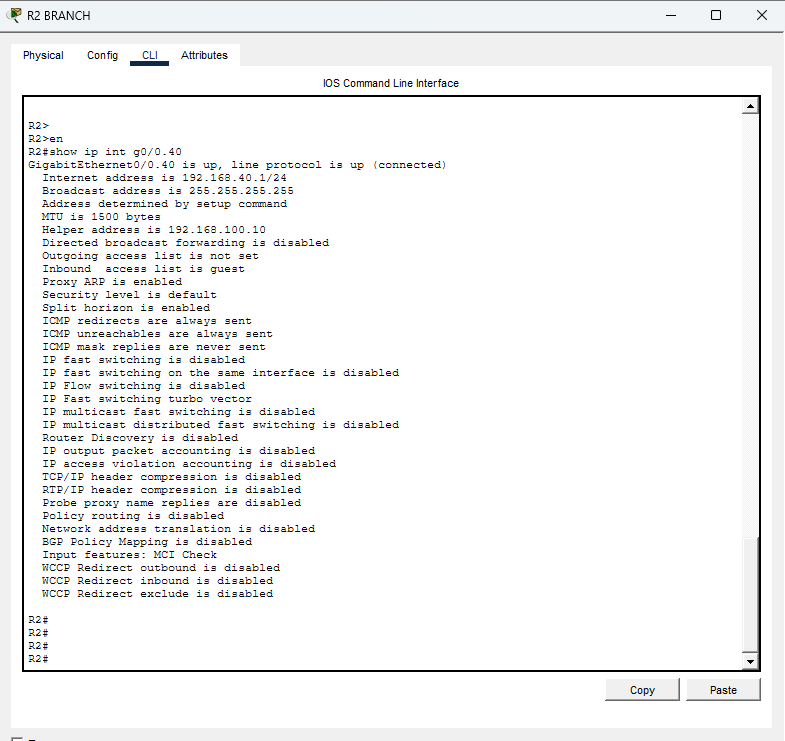
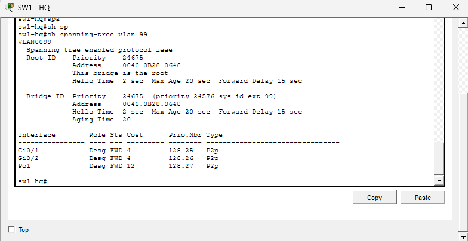
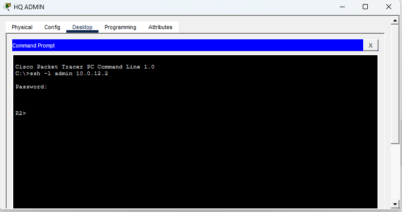
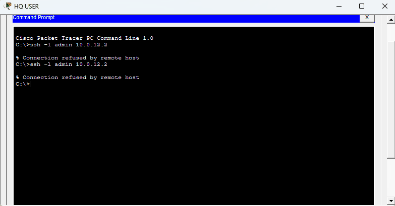

# Verification and Troubleshooting

This page uses the screenshots from my Packet Tracer project as evidence. Each image appears next to the result it supports, with notes about what the screenshot proves and what it does not prove.

## 1. OSPF neighbor between HQ and branch

The branch router has an established OSPF adjacency with the HQ router. In the screenshot below, neighbor ID `1.1.1.1` is in `FULL/BDR` state, with neighbor address `10.0.12.1` on `GigabitEthernet0/1`. The `FULL` state shows that the routers have completed adjacency formation.

## 2. HQ routes and the default route learned through OSPF

The branch routing table shows HQ Users (`192.168.10.0/24`), HQ Admin (`192.168.20.0/24`), HQ Management (`192.168.99.0/24`), and HQ Services (`192.168.100.0/24`) as OSPF-learned routes through `10.0.12.1`. Branch Staff (`192.168.30.0/24`) and Branch Guest (`192.168.40.0/24`) are directly connected to R2.

The same output identifies `10.0.12.1` as the gateway of last resort and displays the OSPF external default route `O*E2 0.0.0.0/0 [110/1]` through that next hop.

## 3. NAT/PAT for Branch Guest traffic

The NAT translation screenshot records a TCP session from Branch Guest host `192.168.40.10:1025`. Its inside-global address is `198.51.100.2:1025`, and the destination is the public web server `203.0.113.10:80`. This is direct evidence that the tested Guest HTTP session was translated by PAT.

The client-side screenshot shows `http://www.test.net` in the browser address bar and the page loaded in Packet Tracer. Together with the NAT entry, this demonstrates successful web access for this test. It does not, by itself, prove PAT was tested from each of the other client VLANs.

## 4. Guest VLAN ACL rules and interface placement

The ACL output shows the intended Guest policy: permit DHCP, permit ICMP to the Guest gateway, permit UDP and TCP DNS queries to the HQ server `192.168.100.10`, and permit HTTP to the public server `203.0.113.10`. It then denies traffic to HQ Admin (`192.168.20.0/24`), HQ Management (`192.168.99.0/24`), and Branch Management (`192.168.199.0/24`), followed by a final deny for all other IP traffic.

The DHCP permit line displays five matches in this capture. An HTTP-rule hit count is not visible here, so this screenshot proves the configured rule set, not an HTTP ACL counter.

The interface output separately confirms that `GigabitEthernet0/0.40` is up/up, uses helper address `192.168.100.10`, and has `guest` listed as its inbound access list. This verifies that the ACL is attached to the Guest subinterface rather than only existing in the configuration.

The browser test above demonstrates that the public web page loaded from the Guest PC. The ACL screenshot does not show an attempted blocked connection; blocked-access results were reported during lab testing, but are not depicted in these screenshots.

## 5. LACP EtherChannel between the HQ switches

The switch output shows port-channel `Po1(SU)` using LACP. Both `Fa0/23(P)` and `Fa0/24(P)` are bundled members. This confirms the EtherChannel is in use and both physical links have joined the port-channel.

## 6. STP root bridge for VLAN 99

SW1-HQ's spanning-tree output shows the Root ID and Bridge ID matching and explicitly states `This bridge is the root`. Its listed interfaces `Gi0/1`, `Gi0/2`, and `Po1` are designated and forwarding for VLAN 99.

This confirms SW1-HQ is the root bridge for VLAN 99. The screenshot is from SW1 itself, so it does not show which port, if any, is blocked on the neighboring switch.

## 7. SSH management source restriction on R2

The authorized test from PC-HQ-ADMIN connects to R2 at `10.0.12.2`. After authentication, the prompt changes to `R2>`, showing that the session succeeded.

The same SSH destination was then tested from PC-HQ-USER. Its terminal shows `Connection refused by remote host` on both attempts. Combined with the successful Admin session, this supports the intended SSH source restriction on R2 for these two tested sources.

This is evidence for R2 and these two source PCs only; equivalent authorized and unauthorized tests have not been captured for every other network device.

## Other verification notes

- The lab work also included successful reachability tests from the ISP router to R1's outside address and to the public server, as well as switch management SVI recovery after trunk and VLAN corrections.
- SSHv2 and local authentication were configured on the tested devices. The screenshots above focus on the successful and refused source tests on R2.
- Several devices selected `192.168.100.10` as their NTP peer, but some Packet Tracer offsets were unusually large. Accurate clock synchronization is not confirmed.

## Troubleshooting notes

### Native VLAN mismatch between SW1 and SW2

**Symptom:** STP reported a PVID inconsistency and VLAN 99 was blocked on the port-channel.

**Cause:** The native VLAN and allowed-VLAN lists did not match on both ends of the HQ trunks.

**Fix:** Both ends were configured to use native VLAN 999 and matching allowed VLANs. VLAN 999 was also created in the VLAN database.

**Verification:** The inconsistency cleared, LACP remained up, and STP handled the redundant Layer 2 design. The STP screenshot above verifies SW1's root status for VLAN 99; the neighboring switch would need to be inspected to show the exact blocking port.

### SW1/SW2 management SVI down

**Symptom:** The management SVI had an IP address but showed `up/down`, and management pings failed.

**Checks:** VLAN 99 existence, trunk native VLAN, trunk allowed VLANs, STP state, and CDP neighbors were inspected.

**Fix and recovery:** After correcting VLAN/trunk settings, SW2's VLAN 99 SVI was shut down and re-enabled. It returned to `up/up`; ping to its gateway and SW1's management address then succeeded.

### R2 SSH connection failed during setup

**Symptom:** SSH to R2's transit address `10.0.12.2` initially failed.

**Cause and fix:** The VTY lines were not consistently configured for local authentication and SSH-only transport. VTY lines 0–15 were configured with `login local` and `transport input ssh`, and SSHv2 was enabled.

**Verification:** The two screenshots in the SSH section now show the successful authorized session and the refused user-PC connection.

### NAT/PAT source scope

**Symptom:** The NAT source ACL originally permitted any source address.

**Fix:** The standard ACL was narrowed to the four client subnets: `192.168.10.0/24`, `192.168.20.0/24`, `192.168.30.0/24`, and `192.168.40.0/24`.

**Verification:** The NAT screenshot demonstrates translation for Branch Guest HTTP traffic. Each of the other client VLANs should be tested separately to confirm its translation.

## Remaining limitations

The evidence here confirms the specific tests illustrated by the screenshots. Further validation could include PAT tests from HQ Users, HQ Admin, and Branch Staff; an explicit screenshot of blocked Guest access; the blocking port on the neighboring switch for VLAN 99; SSH allow/deny tests on the remaining devices; and a stable NTP synchronization result.

The complete Packet Tracer file is [`ccna-mega-capstone.pkt`](ccna-mega-capstone.pkt). Repeat tests from that file so the outputs match the documented project.